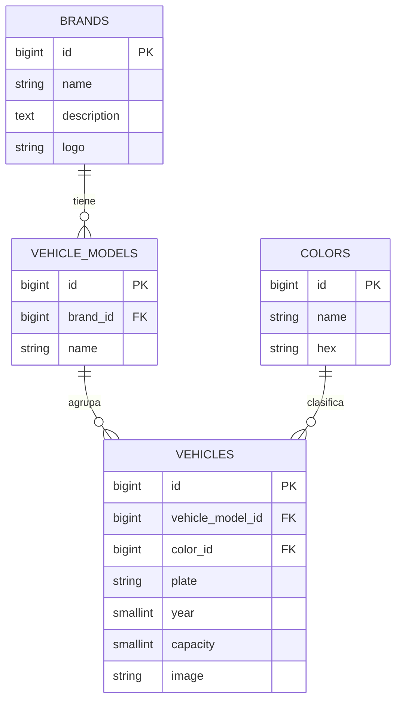

# rsu-project

Panel de administración para la gestión de la flota de vehículos de carga y transporte
(Residuos Sólidos Urbanos — RSU). Permite administrar marcas, modelos, colores y vehículos
con sus imágenes.

## Stack

- **Laravel 12** (PHP 8.5)
- **Jetstream + Livewire 3** para autenticación y UI de cuenta
- **AdminLTE 4** (`jeroennoten/laravel-adminlte`) para el panel de administración
- **MySQL 8.4** como base de datos
- **Laravel Sail** (Docker) para el entorno de desarrollo
- **Vite + Tailwind CSS 3** para los assets

## Modelo de datos



Relaciones e integridad:

- `vehicle_models.brand_id` → `brands` (`cascadeOnDelete`): al eliminar una marca se eliminan sus modelos.
- `vehicles.vehicle_model_id` → `vehicle_models` (`restrictOnDelete`).
- `vehicles.color_id` → `colors` (`restrictOnDelete`).
- `plate` es único; `vehicle_models` es único por `(brand_id, name)`.
- Un modelo de vehículo o un color **no se puede eliminar** si tienen vehículos asociados; una marca
  tampoco si tiene modelos.

## Desarrollo con Docker/Sail

El proyecto se ejecuta con [Laravel Sail](https://laravel.com/docs/sail) sobre Docker. No hace falta
tener PHP, Composer ni Node instalados en el host: todos los comandos corren dentro de los contenedores.

Requisito: tener Docker (con el plugin Compose) funcionando.

```bash
# Alias recomendado para acortar los comandos
alias sail='./vendor/bin/sail'
```

### Primer arranque

```bash
# 1. Instalar dependencias de PHP (si todavía no existe vendor/) con el contenedor de Composer
docker run --rm -u "$(id -u):$(id -g)" -v "$(pwd):/var/www/html" -w /var/www/html \
  laravelsail/php84-composer:latest composer install --ignore-platform-reqs

# 2. Copiar el entorno y levantar los contenedores (app + MySQL)
cp .env.example .env
```

Asegurate de que el `.env` apunte a MySQL con los hosts de Sail:

```dotenv
APP_URL=http://localhost

DB_CONNECTION=mysql
DB_HOST=mysql
DB_PORT=3306
DB_DATABASE=laravel
DB_USERNAME=sail
DB_PASSWORD=password
```

```bash
# 3. Levantar los contenedores
sail up -d

# 4. Preparar la aplicación
sail artisan key:generate
sail artisan migrate
sail artisan storage:link
sail artisan db:seed        # catálogos de ejemplo (idempotente)
sail npm install
sail npm run dev            # o `sail npm run build` para producción
```

La aplicación queda disponible en [http://localhost](http://localhost).

### Comandos habituales

```bash
sail up -d                 # Levantar los contenedores en segundo plano
sail down                  # Detener y eliminar los contenedores
sail artisan <comando>     # Ejecutar cualquier comando de Artisan
sail composer <comando>    # Ejecutar Composer
sail npm <comando>         # Ejecutar npm
sail test                  # Atajo para `sail artisan test`
sail artisan test          # Correr la suite de tests (PHPUnit)
sail shell                 # Abrir una shell dentro del contenedor
sail mysql                 # Abrir el cliente de MySQL
```

Los seeders (`ColorSeeder`, `BrandSeeder`, `VehicleModelSeeder`) usan `updateOrCreate`/`firstOrCreate`,
por lo que se pueden correr varias veces sin duplicar registros.

## Rutas del panel admin

Todas las rutas del panel requieren **autenticación** (middleware `auth`). Las rutas de cuenta y el
dashboard las provee Jetstream.

| Método(s) | Ruta | Descripción |
| --- | --- | --- |
| GET | `/` | Página de bienvenida (pública) |
| GET | `/login`, `/register` | Autenticación y registro (Jetstream) |
| GET | `/dashboard` | Dashboard de Jetstream (autenticado) |
| GET | `/admin` | Panel principal (AdminLTE, autenticado) |
| — | `/brands` | CRUD de marcas (`brands` resource, autenticado) |
| — | `/admin/colors` | CRUD de colores (`colors` resource, autenticado) |
| — | `/admin/vehicle-models` | CRUD de modelos de vehículo (`vehicle-models`, autenticado) |
| — | `/admin/vehicles` | CRUD de vehículos (`vehicles` resource, autenticado) |

## Convención de imágenes

- Se guardan en el disco `public`, en las carpetas `brands/` (marcas) y `vehicles/` (vehículos).
- Nombre de archivo **hasheado** (generado por Laravel); en la base de datos se guarda el **path
  relativo**, nunca la URL.
- La URL se obtiene mediante los accessors `Brand::logo_url` y `Vehicle::image_url`. Si no hay
  imagen, devuelven el placeholder `public/images/no_logo.svg`.
- Validación: `image`, formatos `jpg`, `jpeg`, `png`, `webp`, tamaño máximo **2 MB** (`max:2048`).
- Al reemplazar o eliminar un registro, el archivo anterior se borra del disco.

## License

The Laravel framework is open-sourced software licensed under the [MIT license](https://opensource.org/licenses/MIT).
